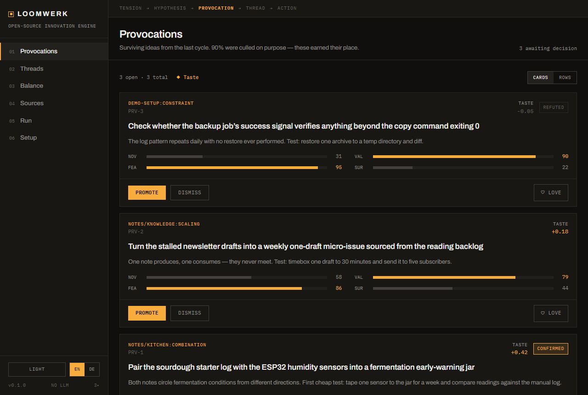
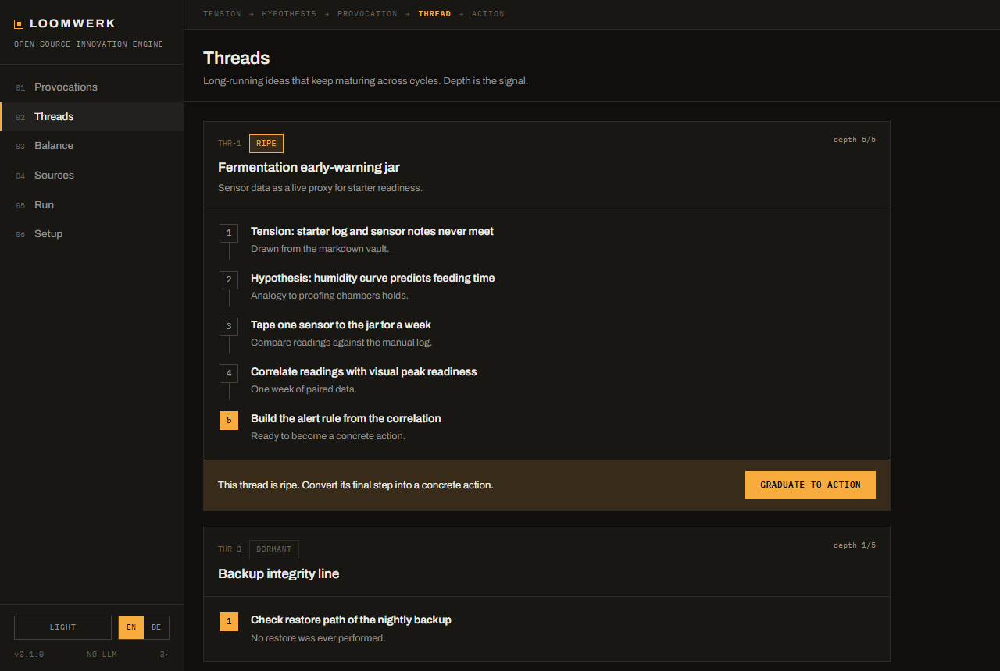
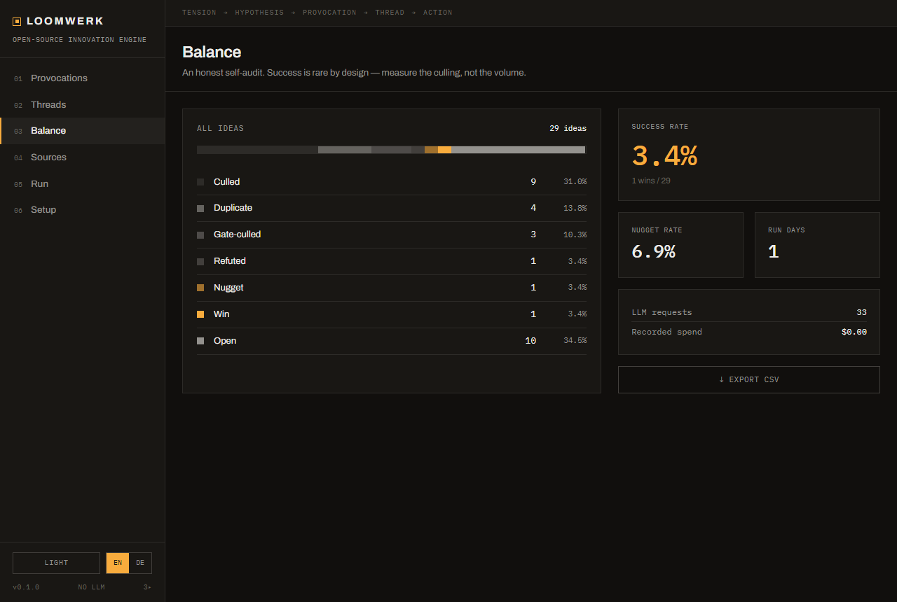

# Loomwerk

[](https://www.npmjs.com/package/loomwerk)
[](https://github.com/GuideThomas/loomwerk/actions)
[](LICENSE)

> Eine offene Innovationsmaschine: Loomwerk züchtet Ideen aus den Spannungen
> deiner eigenen Wissensquellen, sortiert 90 % davon bewusst aus, lernt
> deinen Geschmack aus deinen Entscheidungen — und lässt die Überlebenden in
> langlebigen Fäden reifen.

```bash
npx loomwerk   # → http://127.0.0.1:7791
```

**[English version → README.md](README.md)**

**Stand:** Oktober 2026 · v0.3.3

---

## Warum es das gibt

Die gängige Treppe der KI-Fähigkeiten:

1. **KI-Chatbots** — antworten, wenn man fragt
2. **KI-Agenten** — führen Ziele aus, die du setzt
3. **KI-Innovatoren** — erzeugen Ziele, die es wert sind, gesetzt zu werden
4. AGI

Agenten sind Angestellte: Trigger → Aufgabe → Ergebnis. Ein Angestellter
überrascht nie nützlich. Loomwerk ist ein Versuch am Anfang von Stufe 3 —
ein System, das *Spannungen* in dem beobachtet, was du ohnehin liest,
schreibst und betreibst, daraus Hypothesen züchtet und immer besser lernt,
was du wertvoll finden wirst.

Es ist aus einem privaten System („Atelier") hervorgegangen, das seit Juni
2026 produktiv tägliche Zyklen fährt. Die Zahlen dieses Vorgängers gehören
zum Angebot, weil sie ehrlich sind: **Sechs Wochen tägliche Ideenzucht
kosteten rund 0,10 $ pro Tag; von 227 gezüchteten Ideen wurden ~3 % direkte
Treffer, ~17 % lieferten ein brauchbares Nugget.** Die meisten Ideen
sterben. Das ist kein Fehler — das gesamte Design existiert, damit das
Sterben billig und das Überleben vertrauenswürdig ist.



## Das Denkmodell

```
SPANNUNG  →  HYPOTHESE  →  PROVOKATION  →  FADEN  →  HANDLUNG
  (Saat)     (Variation)    (kuratiert)   (gereift)   (deine)
```

Das Flussdiagramm der Pipeline (mit allen Gates) steht im
[englischen README](README.md#the-mental-model).

- **Spannungen** kommen aus Connectoren: zwei semantisch nahe, aber
  unverbundene Notizen in deinem Vault, zwei Feed-Meldungen, die in
  verschiedene Richtungen zeigen, ein Log-Muster, das sich wiederholt,
  ohne dass jemand hinschaut — oder was immer deine Agenten per API pushen.
- **Pulse** züchtet pro Spannung eine Hypothese auf einem günstigen Modell.
  Hohe Menge, niedrige Erwartung — für sich genommen ist diese Stufe eine
  Slop-Maschine, mit Absicht.
- **Critic** ist das eigentliche Produkt. Fünf Gates, billig vor teuer:
  Pre-Screen → Fakten-Gate → Dubletten-Gate (inklusive *kürzlich
  verworfener* Ideen, damit nichts als Echo zurückkehrt) → ein streng
  kalibrierter Judge → ein Machbarkeits-Floor, der Moonshots unabhängig von
  ihrer Neuheit aussortiert. Danach MAP-Elites-Selektion: Die beste Idee
  **pro Nische** überlebt, nicht die N besten insgesamt — das erhält eine
  vielfältige Front statt zehn Varianten eines Themas.
- **Fitness** lernt deinen Geschmack: Jede deiner Entscheidungen (befördern,
  mit Begründung verwerfen, gefällt mir, ignorieren) trainiert Centroids,
  die künftige Selektion kippen. Deine Verwerfungs-*Begründungen* werden zu
  expliziten Negativ-Anweisungen im Zucht-Prompt.
- **Weave** macht aus den stärksten Überlebenden persistente Fäden und
  vertieft jeden pro Zyklus um genau einen konkreten Schritt — mit einem
  Tiefen-Limit, das ein Verdikt erzwingt statt endloser Ausarbeitung.

Du bleibst die Jury. Die Maschine schlägt vor, der Mensch verfügt — und die
Maschine überstimmt nie eine menschliche Entscheidung (diese Invariante ist
auf Datenbankebene erzwungen, nicht per Konvention).

| Fäden reifen Schritt für Schritt | Die Bilanz wird berechnet, nicht geschätzt |
|---|---|
|  |  |

## Schnellstart

Voraussetzungen: Node ≥ 20 und ein OpenAI-kompatibler LLM-Endpunkt (OpenAI,
OpenRouter, ein lokales Ollama, dein eigenes Gateway).

```bash
git clone https://github.com/GuideThomas/loomwerk
cd loomwerk
npm install
npm run build

LOOMWERK_LLM_BASE_URL=https://api.openai.com/v1 \
LOOMWERK_LLM_API_KEY=sk-… \
npm start
```

Öffne `http://127.0.0.1:7791`. Die Einrichtung führt dich durch Quelle
verbinden und ersten Zyklus starten — ohne konfigurierte Quelle zeigen
gebündelte Demo-Spannungen die komplette Pipeline.

Zyklus vom Terminal aus:

```bash
npm run detect -w server   # Vorschau: welche Saaten deine Quellen liefern
npm run cycle  -w server   # ein voller Pulse → Critic → Fitness → Weave-Lauf
```

Alles ist local-first: eine SQLite-Datei unter `data/`, gebündelte Fonts,
keine Telemetrie, keine Verbindungen außer zu dem LLM-Endpunkt, den du
konfigurierst.

## Quellen

| Typ | Was beobachtet wird | Die gefundene Spannung |
|---|---|---|
| `markdown` | Ein Notiz-Ordner (Obsidian-kompatibel) | Zwei semantisch nahe, aber unverbundene Notizen aus verschiedenen Bereichen |
| `rss` | Beliebige RSS-/Atom-Feeds | Zwei aktuelle Meldungen, die in verschiedene Richtungen zeigen |
| `jsonl` | Zeilenweise Logs (Agenten, Cron, Dienste) | Ein Muster, das sich wiederholt, ohne dass jemand reagiert |
| Webhook | `POST /api/seeds` | Was immer deine Systeme beobachten — CI, Monitoring, andere Agenten |

Der Markdown-Connector bettet jede Notiz genau einmal ein und cacht nach
mtime — ein Vault mit 1.000 Notizen kostet einen initialen Index-Lauf,
danach nur noch Änderungen. Ein eigener Connector ist ~50 Zeilen; siehe
[docs/connectors.md](docs/connectors.md).

## Kostendisziplin

Drei Modell-Ebenen (`cheap` für Zucht und Pre-Screen, `judge` für Bewertung
und Vertiefung, `embed` für Dubletten und Geschmack), **harte tägliche
Grenzen für Requests und optional Tokens**, die Neustarts überstehen, und
saubere Stops bei jedem 429 vom Provider. Eine hängende Schleife soll Cents
kosten, kein Monatsbudget.

Die Buchführung ist ehrlich darüber, was ein OpenAI-kompatibler Endpunkt
verraten kann und was nicht:

- **Tokens** werden immer und überall erfasst — jeder Endpunkt meldet
  Usage. Pro Stufe, pro Lauf und in der Bilanz.
- **Dollar** kommen aus genau zwei Quellen, nie aus einer eingebauten
  Schätzung:
  - *gemessen* — meldet dein Gateway echte Kosten mit der Antwort
    (OpenRouters `usage.cost`, LiteLLMs `x-litellm-response-cost`-Header),
    übernimmt Loomwerk sie unverändert;
  - *bepreist* — konfigurierst du `LOOMWERK_PRICE_*`-Sätze ($/1M Tokens je
    Ebene), werden Kosten aus deinen Sätzen berechnet und so gekennzeichnet.
  Ein Call mit gemessenen Kosten wird nie zusätzlich bepreist. Reine
  OpenAI- oder Ollama-Endpunkte melden keine Preise — dann zeigt die Bilanz
  Tokens und erklärt, warum der Dollar-Wert fehlt.

## Konfiguration

| Variable | Default | Zweck |
|---|---|---|
| `LOOMWERK_LLM_BASE_URL` | — | OpenAI-kompatibler Endpunkt (für Zyklen erforderlich) |
| `LOOMWERK_LLM_API_KEY` | — | API-Key (wird nie gespeichert, nie an den Browser geschickt) |
| `LOOMWERK_MODEL_CHEAP` | `gpt-4o-mini` | Zucht- und Pre-Screen-Ebene |
| `LOOMWERK_MODEL_JUDGE` | cheap-Ebene | Bewertung + Faden-Vertiefung |
| `LOOMWERK_MODEL_EMBED` | `text-embedding-3-small` | Dubletten-Gate + Geschmacksmodell |
| `LOOMWERK_DAILY_LLM_REQUESTS` | `300` | Harte tägliche Request-Grenze über alle Stufen |
| `LOOMWERK_DAILY_LLM_TOKENS` | aus | Optionale harte Token-Tagesgrenze (schützt vor Riesen-Prompts) |
| `LOOMWERK_PRICE_CHEAP` / `LOOMWERK_PRICE_JUDGE` | ungesetzt | `$rein,$raus` pro 1M Tokens, z. B. `0.15,0.60` — aktiviert Satz-Bepreisung |
| `LOOMWERK_PRICE_EMBED` | ungesetzt | `$rein` pro 1M Tokens für die Embed-Ebene |
| `LOOMWERK_CYCLE_HOUR` | ungesetzt | 0–23 für einen automatischen Zyklus pro Tag |
| `LOOMWERK_PORT` / `LOOMWERK_HOST` | `7791` / `127.0.0.1` | Bind-Adresse |
| `LOOMWERK_TOKEN` | ungesetzt | Bearer-Token für die API (setzen, sobald mehr als localhost) |
| `LOOMWERK_ALLOWED_HOSTS` | ungesetzt | Weitere Hostnamen, unter denen der Server antwortet, kommagetrennt (`.example.com` deckt Subdomains ab). IP-Adressen und `localhost` gehen immer; jeder andere `Host` bekommt 403 — Schutz gegen DNS-Rebinding. Setzen, wenn Loomwerk über eine Domain oder einen Docker-Dienstnamen erreicht wird |
| `LOOMWERK_DATA_DIR` | `./data` | SQLite + Connector-Caches |
| `LOOMWERK_ANCHOR_SETUP` / `LOOMWERK_ANCHOR_IDEA` | eingebaut | **Die Personalisierungs-Fläche** — beschreibe deine reale Größenordnung, Fähigkeiten und Grenzen; die Defaults sind bewusst generisch |
| `LOOMWERK_ASSETS_FILE` | `data/assets.md` | Inventar dessen, was du schon hast — Ideen kommen als Erweiterung, nicht als Neubau |
| `LOOMWERK_DEMO_SEEDS` | an | `0` deaktiviert die Demo-Spannungen |

Anfragen anderer Webseiten werden auch ohne Token abgewiesen: Ein
`POST`/`PATCH`/`PUT`/`DELETE`, den der Browser als seitenübergreifend markiert
(`Sec-Fetch-Site`) oder dessen `Origin` nicht Host und Port von Loomwerk selbst
nennt, bekommt 403 — auch eine Seite auf einem anderen localhost-Port gilt als
fremd. curl, Webhooks und Skripte senden keinen der beiden Header und sind
nicht betroffen.

Weitere Stellschrauben (Schwellwerte, Caps, Faden-Tiefe) sind im Quellcode
dokumentiert — jede trägt einen Kommentar mit dem Produktions-Vorfall
dahinter.

## Architektur

npm-Workspaces, durchgängig TypeScript:

```
server/   Express 5 + better-sqlite3 — Lebenszyklus, Engine, Connectoren, API
client/   Vite + React — das Instrumenten-Panel (EN/DE, Hell/Dunkel)
docs/     Design-Brief, Connector-Autoren-Guide
```

Die visuelle Sprache ist in [docs/design-brief.md](docs/design-brief.md)
dokumentiert: Präzisionsinstrument, keine KI-App. Keine Chat-Blasen, kein
Funkeln — Gates, Verdikte und Zahlen.

## Was Loomwerk nicht ist

- **Nicht autonom.** Nichts wird ohne dich ausgeführt; beförderte Ideen
  werden Handlungs-Einträge, die du exportierst — keine Befehle, die es
  selbst ausführt.
- **Kein Chat-Interface.** Du redest nicht mit ihm; du beurteilst seinen
  Output.
- **Kein Mengen-Spiel.** Liefert ein Zyklus null Überlebende, ist das ein
  Ergebnis, kein Fehler.

## MCP-Server

Seit v0.2 bringt Loomwerk einen MCP-Server mit — Claude und andere
MCP-Clients können die Maschine direkt aus einem Gespräch füttern und
ernten:

```bash
claude mcp add loomwerk --env LOOMWERK_DATA_DIR=/pfad/zu/deinen/daten \
  -- npx -y -p loomwerk loomwerk-mcp
```

(Im Repo: `npm run mcp -w server`.) `LOOMWERK_DATA_DIR` auf dasselbe
Verzeichnis wie die App zeigen lassen — SQLite im WAL-Modus teilt sich
problemlos.

Sechs Tools: `ingest_seed` (Spannung pushen, gleicher Contract wie der
Webhook), `list_provocations`, `react`, `list_threads`, `get_balance`,
`run_cycle`. Eine bewusste Regel steckt in den Tool-Beschreibungen:
Reaktionen über MCP zählen als **Verdikte des Users** und trainieren das
Geschmacksmodell — ein Assistent soll nur reagieren, wenn der Mensch
wirklich entschieden hat.

## Roadmap

Best-effort, in grober Reihenfolge:

- **Quellenübergreifende Spannungen** — eine Feed-Meldung gegen eine
  Vault-Notiz paaren; heute bleiben Spannungen innerhalb einer Quelle.
- **Grounding-Automation** — ein automatischer read-only Fakten-Check,
  bevor Ideen deinen Eingang erreichen. Der private Vorgänger betreibt das
  produktiv; die Portierung ist geplant.
- **Handlungs-Export** — Webhook, GitHub-Issue, todo.md, über die
  eingebauten Handlungs-Einträge hinaus.
- **Weitere Connectoren** — IMAP-Newsletter, Browser-Lesezeichen. Beiträge
  willkommen: [docs/connectors.md](docs/connectors.md).

## Lizenz

Dual lizenziert: **[AGPL-3.0-only](LICENSE)** oder eine
**[kommerzielle Lizenz](COMMERCIAL-LICENSE.md)** für Closed-Source- oder
proprietäre SaaS-Nutzung. Beiträge erfordern ein leichtgewichtiges
[CLA](CLA.md), damit die Dual-Lizenzierung möglich bleibt.

Erdacht und gepflegt von **Thomas Winkler** — siehe [NOTICE](NOTICE).
Für akademische Zitate: [CITATION.cff](CITATION.cff).

## Zeit und Zeitzone

Zeitstempel werden als ISO-8601 in UTC mit `Z` gespeichert
(`2026-09-11T19:21:02Z`) und **in der Zeitzone deines Browsers** angezeigt, in
der Sprache der Oberfläche. Die Tageszähler (Anfragen, Tokens) und der
automatische Zyklus (`LOOMWERK_CYCLE_HOUR`) rechnen in der **Ortszeit des
Servers** — läuft die Maschine auf UTC, setzt `TZ` (z. B. `TZ=Europe/Vienna`)
den gewünschten Tag.

## Mitmachen

Gepflegt als arbeitendes System, nicht als Produkt — Issues und PRs werden
best-effort beantwortet. Starte mit [CONTRIBUTING.md](CONTRIBUTING.md); für
alles über einen Bugfix hinaus bitte zuerst ein Issue. Die eigenwilligen
Mechaniken der Engine (Auslese, Anti-Echo, Grounding) haben Gründe, die mit
Blut geschrieben wurden — na gut, mit Tokens.
