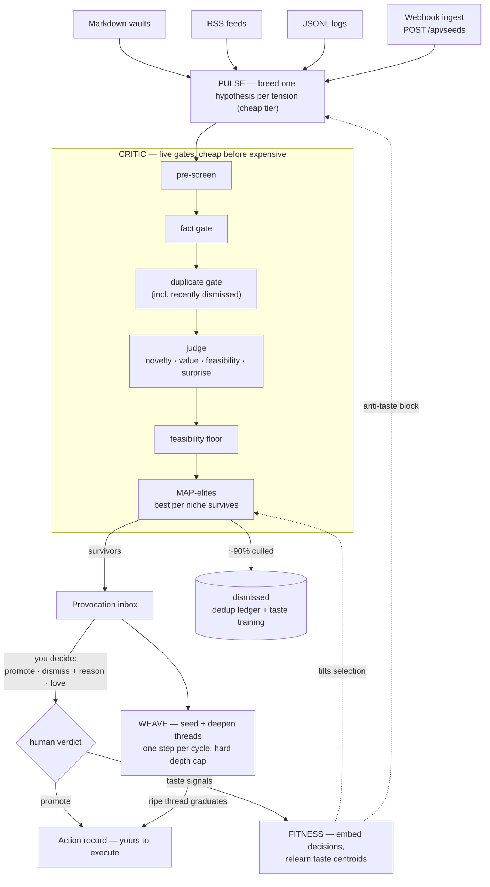

# Loomwerk

> An open innovation engine: Loomwerk breeds ideas from the tensions in your
> own knowledge sources, culls 90% of them on purpose, learns your taste from
> your decisions — and matures the survivors into long-running threads.

**[Deutsche Fassung → README.de.md](README.de.md)**

---

## Why this exists

The commonly drawn staircase of AI capability goes:

1. **AI chatbots** — answer when asked
2. **AI agents** — execute goals you set
3. **AI innovators** — generate goals worth setting
4. AGI

Agents are employees: trigger → task → output. An employee never surprises
you usefully. Loomwerk is an attempt at the start of stage 3 — a system that
observes *tensions* in what you already read, write and run, breeds
hypotheses from them, and gets better at knowing what you'll find valuable.

It grew out of a private system ("Atelier") that has been running daily
cycles in production since June 2026. The numbers from that predecessor are
part of the pitch, because they are honest: **six weeks of daily ideation
cost about $0.10/day; of 227 bred ideas, ~3% became direct wins and ~17%
yielded a usable nugget.** Most ideas die. That is not a bug — the entire
design exists to make the dying cheap and the surviving trustworthy.


## The mental model

```
TENSION  →  HYPOTHESIS  →  PROVOCATION  →  THREAD  →  ACTION
 (seed)     (variation)     (curated)     (matured)   (yours)
```



- **Tensions** come from connectors: two semantically close but unconnected
  notes in your vault, two feed items pointing in different directions, a
  log pattern repeating with nobody looking, anything your agents POST in.
- **Pulse** breeds one hypothesis per tension on a cheap model. High volume,
  low expectations — on its own this stage is a slop machine, by design.
- **Critic** is where the product lives. Five gates, cheap before expensive:
  pre-screen → fact gate → duplicate gate (including *recently dismissed*
  ideas, so nothing comes back as an echo) → a strictly calibrated judge →
  a feasibility floor that kills moonshots regardless of novelty. Then
  MAP-elites selection: the best idea **per niche** survives, not the N
  best overall — that preserves a diverse front instead of ten variants of
  one theme.
- **Fitness** learns your taste: every decision you make (promote, dismiss
  with reason, love, ignore) trains centroids that tilt future selection.
  Your dismissal *reasons* become explicit negative instructions in the
  breeding prompt.
- **Weave** turns the strongest survivors into persistent threads and
  deepens each by exactly one concrete step per cycle — with a depth cap
  that forces a verdict instead of endless elaboration.

You stay the judge. The engine proposes; a human disposes; the machine never
overturns a human decision (that invariant is enforced at the database
layer, not by convention).

| Threads mature step by step | The balance sheet is computed, not estimated |
|---|---|
|  |  |

## Quickstart

Requirements: Node ≥ 20, any OpenAI-compatible LLM endpoint (OpenAI,
OpenRouter, a local Ollama, your own gateway).

```bash
git clone https://github.com/GuideThomas/loomwerk
cd loomwerk
npm install
npm run build

LOOMWERK_LLM_BASE_URL=https://api.openai.com/v1 \
LOOMWERK_LLM_API_KEY=sk-… \
npm start
```

Open `http://127.0.0.1:7791`. The setup flow walks you through connecting a
source and running a first cycle — without any source configured, bundled
demo tensions let you watch the full pipeline work.

To run a cycle from the terminal instead:

```bash
npm run detect -w server   # preview which seeds your sources would yield
npm run cycle  -w server   # one full pulse → critic → fitness → weave pass
```

Everything is local-first: one SQLite file under `data/`, bundled fonts, no
telemetry, no calls to anything except the LLM endpoint you configure.

## Sources

| Kind | What it watches | The tension it finds |
|---|---|---|
| `markdown` | A folder of notes (Obsidian-compatible) | Two notes that are semantically close but from different areas and unconnected |
| `rss` | Any RSS/Atom feed | Two current items pointing in different directions |
| `jsonl` | Line-delimited logs (agents, cron, services) | A message pattern repeating with nobody reacting |
| webhook | `POST /api/seeds` | Whatever your systems observe — CI, monitoring, other agents |

The markdown connector embeds each note once and caches by mtime — a
1,000-note vault costs one initial indexing run, then only changes are paid
for. Writing your own connector is ~50 lines; see
[docs/connectors.md](docs/connectors.md).

## Cost discipline

Three model tiers (`cheap` for breeding and pre-screening, `judge` for
scoring and deepening, `embed` for duplicates and taste), a **hard daily
request cap** that survives restarts, and clean stops on any upstream 429.
A stuck loop should cost cents, not a monthly budget. Every pipeline stage
records an honest run row — counts, requests, failures — and the Balance
screen is computed from those rows, never estimated.

## Configuration

| Variable | Default | Purpose |
|---|---|---|
| `LOOMWERK_LLM_BASE_URL` | — | OpenAI-compatible endpoint (required for cycles) |
| `LOOMWERK_LLM_API_KEY` | — | API key (never stored, never sent to the browser) |
| `LOOMWERK_MODEL_CHEAP` | `gpt-4o-mini` | Breeding + pre-screen tier |
| `LOOMWERK_MODEL_JUDGE` | cheap tier | Scoring + thread deepening tier |
| `LOOMWERK_MODEL_EMBED` | `text-embedding-3-small` | Duplicate gate + taste model |
| `LOOMWERK_DAILY_LLM_REQUESTS` | `300` | Hard daily cap across all stages |
| `LOOMWERK_CYCLE_HOUR` | unset | Set 0–23 for one automatic cycle per day |
| `LOOMWERK_PORT` / `LOOMWERK_HOST` | `7791` / `127.0.0.1` | Bind address |
| `LOOMWERK_TOKEN` | unset | Bearer token for the API (set it when exposing beyond localhost) |
| `LOOMWERK_DATA_DIR` | `./data` | SQLite + connector caches |
| `LOOMWERK_ANCHOR_SETUP` / `LOOMWERK_ANCHOR_IDEA` | built-in | **The personalization surface** — describe your real scale, skills and constraints; the defaults are deliberately generic |
| `LOOMWERK_ASSETS_FILE` | `data/assets.md` | Inventory of things you already have, so ideas arrive as extensions, not rebuilds |
| `LOOMWERK_DEMO_SEEDS` | on | `0` disables the bundled demo tensions |

More knobs (thresholds, caps, thread depth) are documented in the source —
each has a comment explaining the production incident behind it.

## Architecture

npm workspaces, TypeScript throughout:

```
server/   Express 5 + better-sqlite3 — lifecycle, engine, connectors, API
client/   Vite + React — the instrument panel (EN/DE, light/dark)
docs/     design brief, connector author guide
```

The visual language is documented in [docs/design-brief.md](docs/design-brief.md):
precision instrument, not AI app. No chat bubbles, no sparkles — gates,
verdicts and numbers.

## What Loomwerk is not

- **Not autonomous.** Nothing executes without you; promoted ideas become
  action records you export, not commands it runs.
- **Not a chat interface.** You don't talk to it; you judge its output.
- **Not a volume play.** If a cycle produces zero survivors, that is a
  result, not a failure.

## MCP server

Since v0.2 Loomwerk ships an MCP server, so Claude and other MCP clients
can feed the engine and harvest provocations from inside a conversation:

```bash
claude mcp add loomwerk --env LOOMWERK_DATA_DIR=/path/to/your/data \
  -- npx -y -p loomwerk loomwerk-mcp
```

(In the repo: `npm run mcp -w server`.) Point `LOOMWERK_DATA_DIR` at the
same directory the app uses so both see one database — SQLite in WAL mode
shares fine.

Six tools: `ingest_seed` (push a tension, same contract as the webhook),
`list_provocations`, `react`, `list_threads`, `get_balance`, `run_cycle`.
One deliberate rule is baked into the tool descriptions: reactions pushed
through MCP count as the **user's own verdicts** and train the taste model
— an assistant should only react when the user actually decided.

## Roadmap

Best-effort, in rough order:

- **Cross-source tensions** — pair a feed item against a vault note; today
  tensions stay within one source.
- **Grounding automation** — an automatic read-only fact-check pass before
  ideas reach your inbox. The private predecessor runs this in production;
  porting it is planned.
- **Action export targets** — webhook, GitHub issue, plain todo.md, beyond
  the built-in action records.
- **More connectors** — IMAP newsletters, browser bookmarks. Contributions
  welcome: [docs/connectors.md](docs/connectors.md).

## License

Dual-licensed: **[AGPL-3.0-only](LICENSE)** or a
**[commercial license](COMMERCIAL-LICENSE.md)** for closed-source or
proprietary-SaaS use. Contributions require a lightweight
[CLA](CLA.md) to keep dual licensing possible.

Created and maintained by **Thomas Winkler** — see [NOTICE](NOTICE).
If you build on Loomwerk academically, [CITATION.cff](CITATION.cff) has you
covered.

## Contributing

Maintained as a working system, not a product — issues and PRs are answered
best-effort. Start with [CONTRIBUTING.md](CONTRIBUTING.md); for anything
bigger than a bugfix, open an issue first. The engine's opinionated
mechanics (culling, anti-echo, grounding) have reasons written in blood —
well, in tokens.
